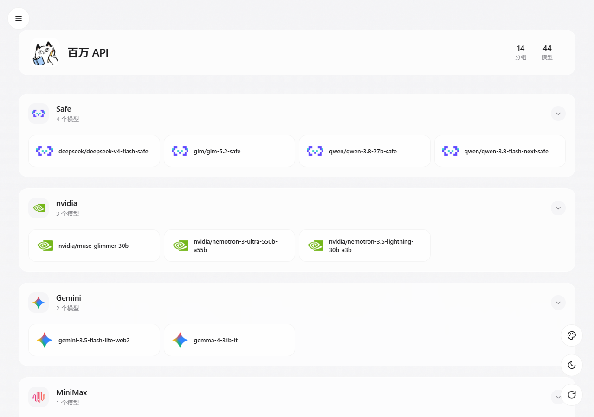
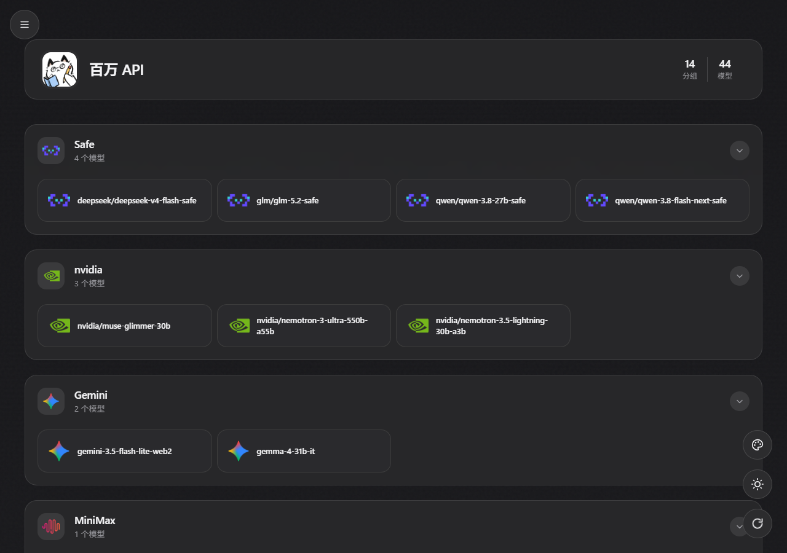
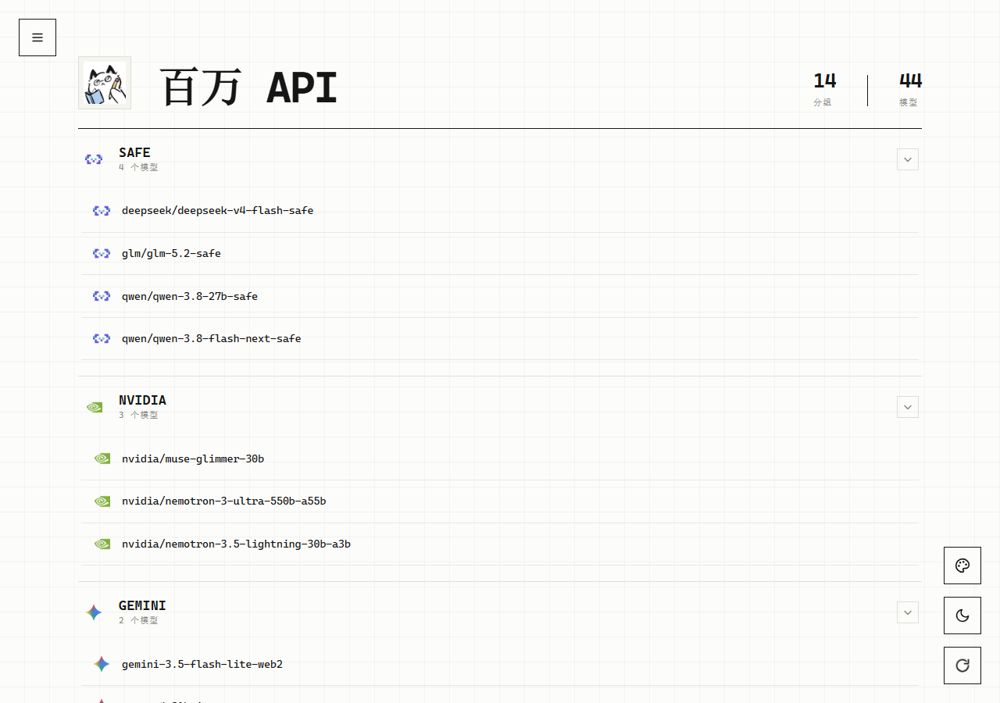
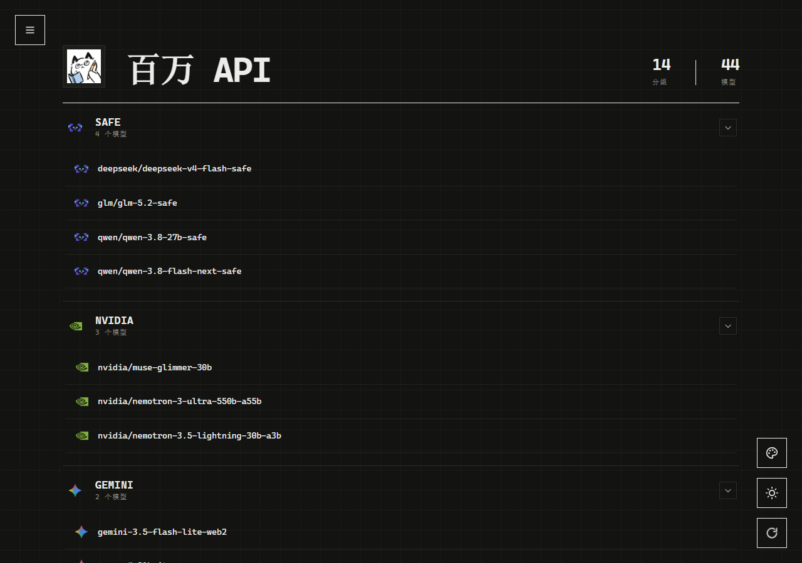
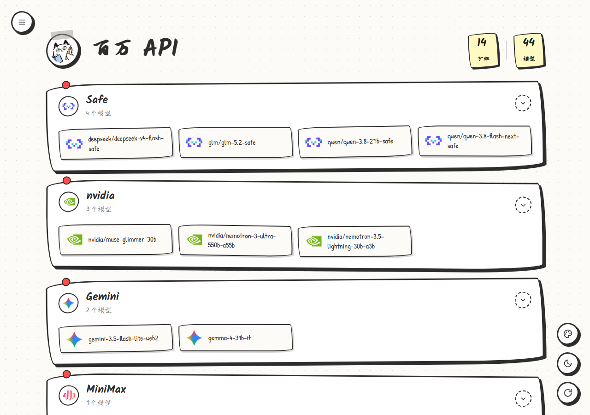
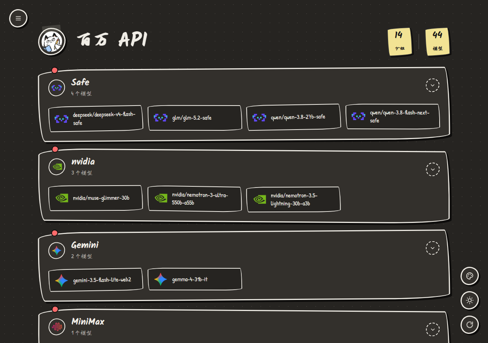

# Model Gallery

一个优雅的 AI 模型列表展示工具，内置多套可切换的主题，自动将获取到的模型按关键词分组，支持多站点切换。专为 NewAPI、OneAPI、DoneHub 等 OpenAI 兼容接口设计。

## 🎨 主题展示

内置 3 套主题（经典 / 档案 / 手绘），每套均支持浅色与深色模式。

| 主题        | 浅色模式                                            | 深色模式                                           |
| ----------- | --------------------------------------------------- | -------------------------------------------------- |
| `classic`   |    |    |
| `archive`   |    |    |
| `handdrawn` |  |  |

## 🚀 快速开始

### 本地运行

1. 安装 Node.js
2. 在项目根目录编辑 `config.json` 文件，填入你的站点配置（参考下方配置说明）
3. 安装依赖并启动开发服务器：
   ```bash
   npm install
   npm run dev
   ```
4. 打开浏览器访问 `http://localhost:3000`

### Vercel 部署

> [!TIP]
> Vercel 打开「获取模型失败」而本地正常？用 [cloudflare/models-proxy.js](./cloudflare/models-proxy.js) 部署反代，再把 `apiUrl` 改为反代域名即可。

1. Fork 项目到你的 GitHub 账号
2. 登录 [Vercel](https://vercel.com)，点击 `Add New Project`
3. 选择你 Fork 的仓库并导入
4. 在 `Environment Variables` 中添加：
   - **Key**: `CONFIG_JSON`
   - **Value**: 你的配置文件 JSON 内容
5. 点击 `Deploy` 等待部署完成，即可通过 `https://your-project.vercel.app` 访问

## ⚙️ 配置说明

### 配置格式

**最简配置示例（使用默认值）：**

```json
{
  "sites": [
    {
      "name": "我的 NewAPI 站点",
      "apiUrl": "https://api.example.com",
      "apiKey": "sk-xxxxxxxxxxxxxxxxxxxxxxxx"
    }
  ]
}
```

**多站点配置示例：**

```json
{
  "sites": [
    {
      "name": "OpenAI 官方",
      "apiUrl": "https://api.openai.com",
      "apiKey": "sk-openai-key",
      "apiEndpoint": "/v1/models",
      "externalUrl": "https://openai.com",
      "iconUrl": "https://example.com/openai-icon.png"
    },
    {
      "name": "硅基流动",
      "apiUrl": "https://api.siliconflow.cn",
      "apiKey": "sk-siliconflow-key",
      "apiEndpoint": "/v1/models",
      "externalUrl": "https://siliconflow.cn",
      "iconUrl": "https://example.com/siliconflow-icon.png"
    },
    {
      "name": "DeepSeek",
      "apiUrl": "https://api.deepseek.com",
      "apiKey": "sk-deepseek-key",
      "apiEndpoint": "/models",
      "externalUrl": "https://deepseek.com",
      "iconUrl": "https://example.com/deepseek-icon.png"
    }
  ],
  "defaultSite": "硅基流动",
  "themes": ["classic", "archive", "handdrawn"],
  "customGroupRules": [
    {
      "name": "翻译",
      "icon": "https://example.com/translation.webp",
      "keywords": ["翻译"],
      "order": 50
    },
    {
      "name": "官转",
      "icon": "https://example.com/official.webp",
      "keywords": ["官转"],
      "order": 850
    },
    {
      "name": "其他自定义",
      "icon": "https://example.com/custom.webp",
      "keywords": ["其他"],
      "order": 5000
    }
  ]
}
```

### 配置字段说明

> [!Important]
> 配置通过 `CONFIG_JSON` 环境变量（优先级更高）或 `config.json` 文件提供。本地开发时编辑 `config.json`（参考 `config.example.json`），改完需重启；Vercel 部署时请将配置内容作为 `CONFIG_JSON` 环境变量的值填入。

#### sites 站点配置

| **字段名**    | **类型** | **说明**                                                 | **默认值**                                   | **是否必选** |
| ------------- | -------- | -------------------------------------------------------- | -------------------------------------------- | ------------ |
| `name`        | String   | 站点名称，显示在页面顶部                                 | -                                            | 必选         |
| `apiUrl`      | URL      | API 基础地址，不能带查询参数或锚点                       | -                                            | 必选         |
| `apiKey`      | String   | API 访问密钥                                             | -                                            | 必选         |
| `apiEndpoint` | String   | API 端点路径，会直接追加在 `apiUrl` 之后，前导斜线可省略 | `/v1/models`                                 | 可选         |
| `externalUrl` | URL      | 图标点击后跳转的链接                                     | `https://github.com/Yesbaiwan/Model-Gallery` | 可选         |
| `iconUrl`     | URL      | 站点图标                                                 | `https://docs.newapi.pro/assets/logo.png`    | 可选         |

#### themes 主题配置（可选）

| **字段名** | **类型** | **说明**                                                                                 | **默认值**                          | **是否必选** |
| ---------- | -------- | ---------------------------------------------------------------------------------------- | ----------------------------------- | ------------ |
| `themes`   | String[] | 启用的主题 id 列表（`classic` 经典 / `archive` 档案 / `handdrawn` 手绘），按配置顺序排列 | 全部主题，默认为第一个（`classic`） | 可选         |

> - 不填或为空数组：启用全部主题，默认「经典」
> - 只填一个：该主题为默认主题，且页面不显示「切换主题」按钮
> - 填两个及以上：第一个为默认主题，页面提供切换功能
> - 配置文件中含未知或重复的 id：配置校验失败，页面会显示具体原因

> [!NOTE]
> 「主题」指皮肤层，与明暗模式相互独立。明暗默认跟随系统；手动切换后固定为浅色或深色，再点一次按钮可回到跟随系统。

#### customGroupRules 自定义分组规则配置（可选）

| **字段名** | **类型** | **说明**                                                   | **默认值**     | **是否必选** |
| ---------- | -------- | ---------------------------------------------------------- | -------------- | ------------ |
| `name`     | String   | 分组显示名称                                               | -              | 必选         |
| `keywords` | String[] | 关键词数组，模型名称在词首出现任意关键词时，则匹配到该分组 | -              | 必选         |
| `icon`     | URL      | 分组图标                                                   | 见下方图标规则 | 可选         |
| `order`    | Number   | 分组排序序号，必须是整数，数字越小越靠前                   | -              | **必选**     |

> - **`order` 必填且唯一**：直接写整数。内置组一律用 100 的整数倍（100…3300），`default` 固定 `9000`；自定义组只要用非整百的数就不会和内置冲突（例如 `1650`、`5000`），想排最前就用 `1–99`。省略、与任何分组重复、或不小于 `default` 的 `9000` 都会报错，例如 `分组 order 1100 重复（"DeepSeek" 与 "新分组"）`。唯一例外：覆盖某个内置组时填它自己的 order 不算冲突。
> - **`keywords` 必填**：自定义新组与覆盖内置组都不继承关键词，需要手动设置。
> - **`icon`**：用户手动填写，未填则用默认的 OpenAI 图标（覆盖内置组未填则延用原图标）。
> - **同名覆盖**：后者覆盖前者，只保留最后一条。
> - **配置错误则系统不可用**

<details>
<summary>内置分组 order 一览</summary>

| order | 分组       | order | 分组      |
| ----- | ---------- | ----- | --------- |
| 100   | OpenAI     | 1800  | Mistral   |
| 200   | Gemini     | 1900  | 豆包      |
| 300   | Claude     | 2000  | 即梦      |
| 400   | MiniMax    | 2100  | BAAI      |
| 500   | Grok       | 2200  | 小米      |
| 600   | Groq       | 2300  | 文心一言  |
| 700   | Nvidia     | 2400  | 快手      |
| 800   | Meta       | 2500  | 阶跃星辰  |
| 900   | Qwen       | 2600  | 硅基流动  |
| 1000  | 智谱       | 2700  | 讯飞      |
| 1100  | DeepSeek   | 2800  | 商汤      |
| 1200  | Kimi       | 2900  | 小红书    |
| 1300  | 混元       | 3000  | 电信星辰  |
| 1400  | Perplexity | 3100  | Agnes     |
| 1500  | 零一万物   | 3200  | Cohere    |
| 1600  | LongCat    | 3300  | Microsoft |
| 1700  | 百灵       | 9000  | default   |

</details>

## 💭 匹配流程

模型 ID 转小写后，按分组 `order` 从小到大逐条比对关键词，**首个命中生效**；全部未命中进入 `default`。

**加关键词的建议**：优先用完整的品牌词或带连字符的写法（如 `yi-`、`step-`、`muse-`、`phi-`、`seed-`、`spark-`），越短越容易误伤；新组与老组撞词时，靠 order 决定谁先命中。

**示例**：

| 模型名称                              | 匹配结果                                                |
| ------------------------------------- | ------------------------------------------------------- |
| `gpt-4-turbo`                         | OpenAI 组的 `gpt`                                       |
| `o1` / `o4-mini`                      | OpenAI 组的 `o1` / `o4`                                 |
| `kling-v3`                            | 快手组的 `kling`（`ling` 因左侧不是边界不会误命中）     |
| `Ling-3.1-flash`                      | 百灵组的 `ling`                                         |
| `nvidia/llama-3.3-nemotron-super-49b` | Nvidia（`order 700` 先于 Meta 的 800，`nvidia` 先命中） |
| `groq/llama-3.3-70b`                  | Groq（`order 600` 先于 Meta 的 800）                    |
| `【翻译】deepseek-v3`                 | `翻译` 组（`order` 小于内置组，排在最前，优先匹配）     |
| `unknown-model`                       | 未命中任何关键词，进入 `default` 组                     |

## 🙏 感谢

感谢 [Lobe Icons](https://github.com/lobehub/lobe-icons) 项目提供的精美图标。
